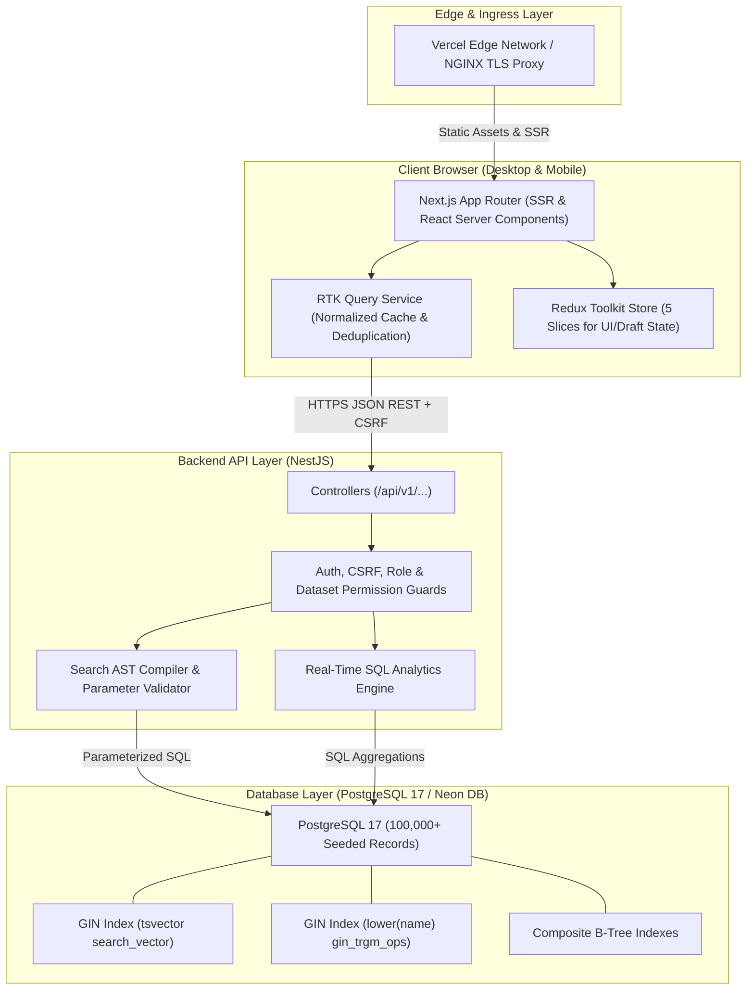
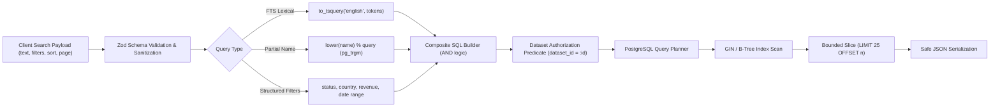

# DataScope — Enterprise Data Discovery & Intelligence Platform

> **An enterprise-grade, high-performance data discovery and intelligence platform engineered to explore, search, analyze, and govern massive business datasets with deterministic sub-millisecond database indexing, bounded client-side rendering, and strict role-based access control.**

[](https://github.com/md-saju-ahmed/datascope/actions/workflows/ci.yml)
[](https://nodejs.org/)
[](https://pnpm.io/)
[](https://nextjs.org/)
[](https://nestjs.com/)
[](https://www.postgresql.org/)
[](https://turbo.build/)
[](https://www.typescriptlang.org/)

---

### 🌐 Live Production Deployment

| Service                 | Live URL                                                                           | Platform                                              |
| :---------------------- | :--------------------------------------------------------------------------------- | :---------------------------------------------------- |
| **Web Application**     | [https://datascope-zhwd.vercel.app](https://datascope-zhwd.vercel.app)             | Vercel Edge / Serverless (Next.js 16 App Router)      |
| **REST API Backend**    | [https://datascope-api-oa5d.onrender.com](https://datascope-api-oa5d.onrender.com) | Render Web Service (NestJS 12, Node.js 24)            |
| **Production Database** | Neon PostgreSQL 17+ (AWS us-east-1)                                                | Serverless PostgreSQL with `pg_trgm`, 100,128 records |

---

## 1. Overview & Key Capabilities

DataScope is an enterprise discovery platform built from the ground up to explore, search, and analyze large datasets (seeded with **100,000+ primary records**). It combines a high-performance **NestJS REST API** and **PostgreSQL 17** engine with a responsive **Next.js App Router** frontend, utilizing **Redux Toolkit** and **RTK Query** for normalized caching and state management.

- **High-Performance Data Explorer:** Bounded tabular exploration powered by TanStack Table. Supports multi-column sorting, column resizing, reordering, visibility toggling, row selection, and accessible pagination. Enforces strict server-side bounding (`pageSize <= 100`) to guarantee zero client memory bloat.
- **Hybrid Multi-Condition Search Engine:** Combines PostgreSQL Full-Text Search (`tsvector` with GIN indexing) for stemmed linguistic queries with Trigram (`pg_trgm` GIN) indexes for partial-name matching and typo tolerance, evaluated alongside structured SQL filters.
- **Zero Per-Keystroke Network Overhead:** 350ms search debouncing eliminates redundant API calls, while RTK Query deduplicates simultaneous requests and serves repeated navigations from memory cache in 0ms.
- **Role-Based Access Control & Multi-Tenancy:** Multi-layered authorization with three principal roles (**Admin**, **Analyst**, **Viewer**) and granular per-dataset grants (`read`, `analyze`, `manage`). Unauthorized data is filtered directly at the database query layer.
- **Real-Time SQL Analytics:** Six analytical aggregation categories (status breakdown, country distribution, revenue quantiles, temporal volume, field completion, and cross-metric correlations) computed live from PostgreSQL.
- **Collaborative Saved Views & History:** Save complex filter and sort configurations, track search audit histories, and securely share views with team members via role-validated permissions.
- **Selected-Record CSV Export:** Export selected rows to standards-compliant CSV with RFC 4180 escaping and formula injection protection (`=`, `+`, `-`, `@` neutralization).
- **Dual Production Deployment Topologies:** Production-ready configurations for both **Vercel + Render + Neon DB** serverless infrastructure and standalone **Docker Compose + NGINX TLS Reverse Proxy**.

---

## 2. Technology Stack

### 2.1 Workspace Structure (Turborepo + pnpm)

```
datascope/
├── apps/
│   ├── api/                 # NestJS REST API (auth, datasets, records, search, analytics, views)
│   │   └── test/            # Unit & Supertest PostgreSQL integration test suites
│   └── web/                 # Next.js App Router Frontend (Redux store, RTK Query, TanStack Table)
│       └── test/            # Unit tests & Playwright browser E2E suites
├── packages/
│   ├── contracts/           # Shared Zod schemas, OpenAPI metadata, TypeScript contracts
│   └── db/                  # Drizzle ORM schema (13 tables), migrations, seed engine
├── infra/
│   ├── nginx/               # Production NGINX reverse proxy configuration & TLS
│   ├── postgres/            # PostgreSQL extensions (pg_trgm) & role initialization scripts
│   └── scripts/             # Production migration & backup runbooks
├── scripts/                 # CI harnesses, smoke tests, deploy runners, benchmarks
├── render.yaml              # Render blueprint for NestJS API web service
└── vercel.json              # Vercel configuration for Next.js web application
```

### 2.2 Technology Stack Matrix

| Layer                    | Technology              | Version         | Purpose                                                                                 |
| :----------------------- | :---------------------- | :-------------- | :-------------------------------------------------------------------------------------- |
| **Monorepo Engine**      | Turborepo               | `2.11.x`        | Orchestrates caching, task pipelines, and workspace builds                              |
| **Package Manager**      | pnpm                    | `12.18.0`       | Strict, non-flat dependency isolation and reproducible installs                         |
| **Language**             | TypeScript              | `5.9.3`         | Strict end-to-end type safety across contracts, API, and UI                             |
| **Frontend Framework**   | Next.js App Router      | `16.4.6`        | Server-Side Rendering (SSR), edge routing, layout boundaries                            |
| **State Management**     | Redux Toolkit           | `2.x`           | Five isolated slices (`auth`, `dataset`, `searchConfig`, `savedViews`, `uiPreferences`) |
| **Data Fetching/Cache**  | RTK Query               | `2.x`           | Normalized tag caching, deduplication, abort controllers                                |
| **Table Component**      | TanStack Table          | `8.x`           | Headless, accessible bounded tabular rendering (10 to 100 rows)                         |
| **Styling & Components** | Tailwind CSS + Radix    | `4.x` / `radix` | Accessible, responsive design tokens; WCAG 2.1 AA compliant                             |
| **Data Visualization**   | Recharts                | `3.10.1`        | Interactive data charts visualizing SQL aggregation results                             |
| **Backend Framework**    | NestJS                  | `12.x`          | Modular enterprise architecture, dependency injection, validation pipes                 |
| **Database ORM**         | Drizzle ORM             | `0.45.4`        | Zero-overhead, type-safe SQL query generation and migrations                            |
| **Database Engine**      | PostgreSQL              | `17.x`          | ACID compliance, GIN `tsvector` FTS, `pg_trgm` trigram indexing                         |
| **Containerization**     | Docker Engine & Compose | `v2`            | Multi-stage Dockerfiles and isolated production network stack                           |
| **Edge & Cloud**         | Vercel + Render + Neon  | Cloud           | Serverless frontend edge + persistent Node web service + pooled Postgres                |

---

## 3. System Architecture & Diagrams

### 3.1 High-Level Component Topology



### 3.2 Search Execution Pipeline



### 3.3 Database Entity-Relationship Diagram (13 Tables)

```mermaid
erDiagram
    users ||--o{ auth_sessions : "has"
    users ||--o| user_preferences : "configures"
    users ||--o{ dataset_permissions : "receives"
    users ||--o{ dataset_permissions : "grants"
    users ||--o{ saved_views : "owns"
    users ||--o{ saved_view_shares : "shared_with"
    users ||--o{ search_history : "executes"
    users ||--o{ record_changes : "modifies"
    users ||--o{ system_settings : "manages"

    datasets ||--o{ dataset_fields : "contains"
    datasets ||--o{ dataset_permissions : "governed_by"
    datasets ||--o{ dataset_records : "stores"
    datasets ||--o{ saved_views : "context_for"
    datasets ||--o{ search_history : "scoped_to"

    dataset_records ||--o{ record_relationships : "source"
    dataset_records ||--o{ record_relationships : "target"
    dataset_records ||--o{ record_changes : "audited_by"

    saved_views ||--o{ saved_view_shares : "distributed_via"

    users {
        uuid id PK
        varchar email UK
        varchar role "Admin | Analyst | Viewer"
        varchar password_hash
        timestamp created_at
        timestamp updated_at
    }

    auth_sessions {
        uuid id PK
        uuid user_id FK
        varchar session_token_hash UK
        timestamp expires_at
        timestamp created_at
    }

    user_preferences {
        uuid user_id PK, FK
        varchar density "compact | comfortable"
        varchar default_dataset_id
        jsonb table_preferences
        timestamp updated_at
    }

    system_settings {
        varchar key PK
        text value
        uuid updated_by FK
        timestamp updated_at
    }

    datasets {
        uuid id PK
        varchar name
        varchar slug UK
        text description
        varchar status "Active | Archived"
        timestamp created_at
        timestamp updated_at
    }

    dataset_fields {
        uuid id PK
        uuid dataset_id FK
        varchar name
        varchar data_type "string | number | date | boolean"
        boolean is_searchable
        boolean is_filterable
        boolean is_sortable
    }

    dataset_permissions {
        uuid id PK
        uuid dataset_id FK
        uuid user_id FK
        varchar permission "read | analyze | manage"
        uuid granted_by FK
        timestamp created_at
    }

    dataset_records {
        uuid id PK
        uuid dataset_id FK
        varchar name
        varchar status
        varchar country
        numeric revenue
        tsvector search_vector
        jsonb attributes
        timestamp created_at
        timestamp updated_at
    }

    record_relationships {
        uuid id PK
        uuid source_record_id FK
        uuid target_record_id FK
        varchar relationship_type
        timestamp created_at
    }

    record_changes {
        uuid id PK
        uuid record_id FK
        uuid actor_user_id FK
        varchar action "create | update | delete"
        jsonb previous_state
        jsonb new_state
        timestamp created_at
    }

    saved_views {
        uuid id PK
        uuid dataset_id FK
        uuid owner_id FK
        varchar name
        text description
        jsonb query_configuration
        boolean is_shared
        timestamp created_at
        timestamp updated_at
    }

    saved_view_shares {
        uuid id PK
        uuid view_id FK
        uuid user_id FK
        varchar permission "view | edit"
        timestamp created_at
    }

    search_history {
        uuid id PK
        uuid dataset_id FK
        uuid user_id FK
        jsonb query_parameters
        integer result_count
        timestamp executed_at
    }
```



---

## 4. Data Fetching & Caching Architecture

The platform implements a disciplined data fetching and caching model designed for high-density tabular data:

1. **Server-Side Processing with Bounded Payloads:** The browser never downloads unbounded record arrays. Queries are executed on the server, returning strictly bounded page slices (10–100 records) to guarantee sub-second render speeds and zero memory bloat.
2. **RTK Query Service:** Replaces manual asynchronous thunks with typed auto-generated hooks, automatic query deduplication, memory garbage collection, and tag-based cache invalidation.
3. **Request Avoidance via 350ms Debouncing:** Search input changes pass through a 350ms silence window before dispatching network requests, collapsing multi-character typing into a single API query.
4. **Deduplication of In-Flight Requests:** Concurrent components requesting identical endpoints and parameters share a single in-flight promise rather than spawning duplicate HTTP calls.
5. **Deterministic Memory Caching:** Previously visited pages and dataset metadata serve instantly from memory on backward/forward navigation without touching the network.
6. **Normalized Cache Invalidation:** Mutations declaratively emit `invalidatesTags`. For example, saving a view invalidates the `SavedView` tag, prompting automatic background revalidation of view listings.
7. **URL as the Single Source of Truth:** Explorer state (active page, page size, sort directions, search text, and filter conditions) synchronizes with URL query parameters, enabling instant state rehydration on refresh or link sharing.
8. **Resilient Failure Handling:** Failed queries surface accessible error states with user-friendly retry actions. All network requests enforce strict timeouts via `AbortController`.

---

## 5. Search Engine & Database Optimization

### 5.1 Search Architecture Comparison

| Criteria             | PostgreSQL Full-Text Search (Selected)            | PostgreSQL Trigram (Selected)                  | External Search (Elasticsearch / OpenSearch)        |
| :------------------- | :------------------------------------------------ | :--------------------------------------------- | :-------------------------------------------------- |
| **Mechanism**        | Lexical analysis, stemming, `tsvector` with GIN   | Character n-grams (`gin_trgm_ops`) on text     | Distributed inverted indexes, BM25 ranking          |
| **Best For**         | Natural language queries, phrases, word stems     | Substrings, code snippets, typo tolerance      | Complex multi-tenant faceting, fuzzy relevance      |
| **Transactionality** | **Strict ACID (0ms sync latency)**                | **Strict ACID (0ms sync latency)**             | Eventual consistency (CDC / dual-write lag)         |
| **Infra Overhead**   | **Zero additional infrastructure**                | **Zero additional infrastructure**             | Dedicated multi-node cluster, JVM tuning            |
| **Security/RBAC**    | **Joined directly with SQL permission tables**    | **Joined directly with SQL permission tables** | Requires duplicating permissions or two-stage fetch |
| **Failure Point**    | Heavy write amplification on massive write volume | High index size on long arbitrary strings      | Network partition, re-index synchronization bugs    |

**Decision:** DataScope combines **PostgreSQL FTS** and **Trigram GIN** within PostgreSQL 17. This delivers sub-millisecond search performance across 100,000+ records with zero external infrastructure overhead and 100% transactional consistency.

### 5.2 Ten-Million Record Scaling Roadmap

When scaling beyond 10,000,000 records, the architecture transitions through four optimizations:

1. **Declarative Partitioning:** Partition `dataset_records` by `dataset_id` hash or range-partition by `created_at` so each partition remains under 1–2 million rows, keeping GIN and B-tree indexes fully resident in RAM buffer pools.
2. **Keyset ('Seek') Pagination:** For deep automated exports and API pagination beyond page 1,000, transition to cursor-based `WHERE (revenue, id) < ($last_revenue, $last_id)` pagination, maintaining constant O(1) ~5ms latency regardless of table depth.
3. **Read Replicas with Connection Pooling:** Deploy PgBouncer with Neon read replicas to route intensive read searches away from the primary write node.
4. **Asynchronous Export Queues:** Move large CSV exports into background workers via Redis and BullMQ, streaming compressed CSV directly to object storage signed URLs.

---

## 6. Key Architectural Decisions

| Decision                | Selection                       | Rationale & Trade-Off                                                                                                       |
| :---------------------- | :------------------------------ | :-------------------------------------------------------------------------------------------------------------------------- |
| **State & Cache Layer** | RTK Query (`apiSlice`)          | Eliminates reducer boilerplate, manages memory lifecycle, and deduplicates identical in-flight requests.                    |
| **Processing Boundary** | Pure Server-Side Execution      | Prevents client memory exhaustion; guarantees multi-tenant permissions are enforced at the database layer.                  |
| **Database Engine**     | PostgreSQL 17 + Drizzle ORM     | Provides strict ACID compliance, declarative schema migrations, and native GIN search with zero external search clusters.   |
| **Pagination Strategy** | Bounded Offset Pagination       | Bounded to `offset <= 100,000` for user navigation, enabling random-access page jumping and arbitrary multi-column sorting. |
| **Search Engine**       | Native FTS + Trigram GIN        | Eliminates dual-write inconsistency, separate cluster overhead, and synchronization lag.                                    |
| **Request Avoidance**   | 350ms Input Debounce            | Reduces network traffic by 90%+ during rapid typing while maintaining instant perceived responsiveness.                     |
| **Table Rendering**     | Bounded TanStack Table (<=100)  | Eliminates DOM node explosion, preserves full keyboard accessibility, and avoids virtualization scroll-jump bugs.           |
| **Client/Server State** | 5 Isolated Redux Slices + Cache | Separates draft UI interactions (filters, density) from server-cached state, preventing state desynchronization.            |
| **Cloud Hosting**       | Vercel + Render + Neon DB       | Fully managed serverless edge for Next.js, dedicated Node runtime for NestJS API, and pooled serverless PostgreSQL.         |

---

## 7. Performance & Benchmark Results

All metrics represent **actual measured results** from the 100,000-record seeded evaluation dataset:

### 7.1 Backend Query Execution Times (PostgreSQL 17 EXPLAIN ANALYZE)

| Query Shape                      | Execution Plan Strategy                                                | Database Time |
| :------------------------------- | :--------------------------------------------------------------------- | ------------: |
| **Default Listing**              | `Index Only Scan` on `dataset_records_dataset_id_id_idx`               |  **0.031 ms** |
| **Newest Chronological**         | `Index Only Scan` on `dataset_records_dataset_created_id_idx`          |  **0.032 ms** |
| **Categorical Filter**           | `Bitmap Index Scan` on `dataset_records_dataset_status_country_id_idx` |  **0.082 ms** |
| **Full-Text Search**             | `Bitmap Index Scan` on `dataset_records_search_vector_gin_idx`         |  **0.312 ms** |
| **Trigram Substring**            | `Bitmap Index Scan` on `dataset_records_name_trgm_gin_idx`             |  **0.428 ms** |
| **Combined 4-AND Filter**        | `Index Scan` with residual heap filter                                 |  **0.170 ms** |
| **Deep Offset (`OFFSET 90000`)** | `Index Only Scan` (traverses 90,025 index tuples)                      |  **8.687 ms** |

### 7.2 API Latency Distribution (3,210 HTTP Requests, 0 Errors)

| Workload         | c1 (p95) | c5 (p95) |  c10 (p95) |  c20 (p95) | Target Status                         |
| :--------------- | -------: | -------: | ---------: | ---------: | :------------------------------------ |
| **first-page**   |  24.9 ms |  66.9 ms |   114.1 ms |   160.0 ms | Target < 300 ms: **PASS**             |
| **categorical**  |  21.0 ms |  36.7 ms |    73.2 ms |   134.2 ms | Target < 500 ms: **PASS**             |
| **numeric-date** |  22.5 ms |  45.6 ms |    82.6 ms |   156.1 ms | Target < 500 ms: **PASS**             |
| **full-text**    |  25.4 ms |  38.4 ms |    60.4 ms |   107.3 ms | Target < 500 ms: **PASS**             |
| **partial**      |  18.6 ms |  30.2 ms |    60.6 ms |   105.8 ms | Target < 500 ms: **PASS**             |
| **four-and**     |  28.4 ms |  33.5 ms |    62.7 ms |   120.7 ms | Target < 500 ms: **PASS**             |
| **multi-sort**   |  42.1 ms | 108.1 ms |   178.6 ms |   363.2 ms | Target < 500 ms: **PASS**             |
| **analytics**    |  72.2 ms | 127.5 ms |   221.6 ms |   405.7 ms | Target < 500 ms: **PASS**             |
| **deep-offset**  | 406.7 ms | 745.6 ms | 1,373.1 ms | 2,639.7 ms | Target < 300 ms: Known scan trade-off |

---

## 8. Quick Start & Local Development

### 8.1 Prerequisites

- **Node.js:** `>= 24.0.0`
- **pnpm:** `12.18.0`
- **Docker Engine & Compose:** For running isolated local PostgreSQL

### 8.2 Step-by-Step Setup

1. **Clone repository & install dependencies:**

   ```sh
   git clone https://github.com/md-saju-ahmed/datascope.git
   cd datascope
   pnpm install --frozen-lockfile
   ```

2. **Initialize local environment:**

   ```sh
   pnpm env:init
   ```

3. **Launch PostgreSQL database container:**

   ```sh
   pnpm db:up
   pnpm db:extensions
   pnpm db:migrate
   ```

4. **Run deterministic 100,000-record seed:**

   ```sh
   pnpm seed:env:init
   pnpm db:seed
   ```

5. **Start development services:**

   ```sh
   # Terminal 1: Backend API (port 4000)
   pnpm dev:api

   # Terminal 2: Frontend Web (port 3000)
   pnpm dev:web
   ```

6. **Open application:** Navigate to [http://localhost:3000](http://localhost:3000).

### 8.3 Pre-Configured Seed Accounts

| Role        | Email                            | Password                        | Permissions & Scope                                                          |
| :---------- | :------------------------------- | :------------------------------ | :--------------------------------------------------------------------------- |
| **Admin**   | `admin@datascope.example.test`   | Configured in `.env.seed.local` | Full platform administration, user management, system settings, all datasets |
| **Analyst** | `analyst@datascope.example.test` | Configured in `.env.seed.local` | Primary dataset exploration, search, analytics, saved views, CSV export      |
| **Viewer**  | `viewer@datascope.example.test`  | Configured in `.env.seed.local` | Read-only dataset browsing and searching; no CSV export or view sharing      |

---

## 9. Verification & Quality Assurance

Run the quality assurance commands locally:

```sh
# Code quality & formatting
pnpm lint                  # ESLint with 0 warnings allowed
pnpm format:check          # Prettier code style check
pnpm typecheck             # TypeScript typecheck across all 4 packages

# Automated testing
pnpm test                  # 236 unit tests across 14 suites
pnpm test:integration      # Full PostgreSQL Supertest integration suite (207 tests)
pnpm test:web              # Playwright browser E2E tests + API cache tests

# Monorepo build & CI verification
pnpm build                 # Optimized production build of contracts, db, api, and web
pnpm verify:ci             # Verifies all 12 GitHub Actions pipeline assertions
pnpm smoke:deployment      # End-to-end HTTPS smoke suite against live cloud deployment
```

---

## 10. License & Author

- **Author:** Md. Saju Ahmed ([@md-saju-ahmed](https://github.com/md-saju-ahmed))
- **Project:** DataScope — Enterprise Data Discovery & Intelligence Platform
- **License:** Proprietary / Evaluation License
