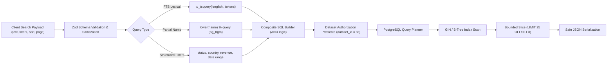

# DataScope — Enterprise Data Discovery & Intelligence Platform

> **An enterprise-grade, high-performance data discovery and intelligence platform engineered to explore, search, analyze, and govern massive business datasets with deterministic sub-millisecond database indexing, bounded client-side rendering, and strict role-based access control.**

[](https://github.com/md-saju-ahmed/datascope/actions/workflows/ci.yml)
[](https://nodejs.org/)
[](https://pnpm.io/)
[](https://nextjs.org/)
[](https://nestjs.com/)
[](https://www.postgresql.org/)
[](https://turbo.build/)
[](https://www.typescriptlang.org/)

---

## 1. Executive Summary & Core Capabilities

DataScope is an enterprise discovery platform built from the ground up to solve the challenges of exploring, searching, and managing large datasets (seeded with **100,000+ primary records**). It combines a high-performance **NestJS REST API** and **PostgreSQL 17** engine with a responsive **Next.js App Router** frontend, utilizing **Redux Toolkit** and **RTK Query** for normalized caching and state management.

### Key Capabilities

- 📊 **High-Performance Data Explorer (`FR-02`, `FR-06`):** Bounded tabular exploration powered by TanStack Table. Supports multi-column sorting, column resizing, reordering, visibility toggling, row selection, and accessible pagination. Enforces strict server-side bounding (`pageSize <= 100`) to guarantee zero client memory bloat.
- 🔍 **Hybrid Multi-Condition Search Engine (`FR-03`, `SR-01`):** Combines PostgreSQL Full-Text Search (`tsvector` with GIN indexing) for stemmed linguistic searches with Trigram (`pg_trgm` GIN) indexes for partial-name matching and typo tolerance, evaluated alongside structured SQL filters.
- ⏱️ **Zero Per-Keystroke Network Overhead (`DF-01`, `DF-03`):** 350ms search debouncing eliminates redundant API calls, while RTK Query deduplicates simultaneous requests and serves repeated navigations from memory cache in 0ms.
- 🛡️ **Role-Based Access Control & Multi-Tenancy (`FR-09`):** Multi-layered authorization with three principal roles (**Admin**, **Analyst**, **Viewer**) and granular per-dataset grants (`read`, `analyze`, `manage`). Unauthorized data is filtered directly at the database query layer.
- 📈 **Real-Time SQL Analytics (`FR-08`):** Six analytical aggregation categories (status breakdown, country distribution, revenue quantiles, temporal volume, field completion, and cross-metric correlations) computed live from PostgreSQL with zero fabricated mock metrics.
- 💾 **Collaborative Saved Views & History (`FR-07`):** Save complex filter and sort configurations, track search audit histories, and securely share views with team members via role-validated permissions.
- 📥 **Selected-Record CSV Export (`FR-10`):** Analyst and Admin users can export selected rows to standards-compliant CSV with RFC 4180 escaping and formula injection protection (`=`, `+`, `-`, `@` neutralization).
- ☁️ **Dual Production Deployment Topologies (`REL-01`, `REL-03`):** Production-ready configurations for both **Vercel + Render + Neon DB** serverless infrastructure and standalone **Docker Compose + NGINX TLS Reverse Proxy**.

---

## 2. Technology Stack & Architecture

### 2.1 Workspace Structure (Turborepo + pnpm)

```
datascope/
├── apps/
│   ├── api/                 # NestJS 11 REST API Application
│   │   ├── src/             # Modules: auth, datasets, records, search, analytics, views, admin
│   │   └── test/            # Unit & Supertest PostgreSQL integration test suites
│   └── web/                 # Next.js 16 App Router Frontend
│       ├── src/             # Pages, Redux store (5 slices), RTK Query API, TanStack Table
│       └── test/            # Jest unit tests & Playwright Chrome browser E2E suites
├── packages/
│   ├── contracts/           # Shared Zod schemas, OpenAPI metadata, TypeScript contracts
│   └── db/                  # Drizzle ORM schema (13 tables), migrations, seed engine
├── infra/
│   ├── nginx/               # Production NGINX reverse proxy configuration & TLS
│   ├── postgres/            # PostgreSQL extensions (pg_trgm) & role initialization scripts
│   └── scripts/             # Production migration & backup (.dump) operational runbooks
├── scripts/                 # CI harnesses, smoke tests, deploy runners, benchmarks
├── render.yaml              # Render blueprint for NestJS API web service
└── vercel.json              # Vercel configuration for Next.js web application
```

### 2.2 Technology Stack Matrix

| Layer                    | Technology               | Version         | Architectural Purpose                                                                                            |
| :----------------------- | :----------------------- | :-------------- | :--------------------------------------------------------------------------------------------------------------- |
| **Monorepo Engine**      | Turborepo                | `2.11.x`        | Orchestrates caching, task pipelines, and workspace builds                                                       |
| **Package Manager**      | pnpm                     | `12.18.0`       | Strict, non-flat dependency isolation and reproducible installs                                                  |
| **Language**             | TypeScript               | `5.9.3`         | Strict end-to-end type safety across contracts, API, and UI                                                      |
| **Frontend Framework**   | Next.js App Router       | `16.4.6`        | Server-Side Rendering (SSR), edge routing, layout boundaries                                                     |
| **State Management**     | Redux Toolkit            | `2.x`           | Five isolated slices for UI intent (`auth`, `dataset`, `searchConfig`, `savedViews`, `uiPreferences`)            |
| **Data Fetching/Cache**  | RTK Query                | `2.x`           | Normalized tag caching (`Dataset`, `Record`, `SavedView`, `Analytics`, `User`), deduplication, abort controllers |
| **Table Component**      | TanStack Table           | `8.x`           | Headless, accessible bounded tabular rendering (10 to 100 rows)                                                  |
| **Styling & Components** | Tailwind CSS + shadcn/ui | `4.x` / `radix` | Accessible, responsive design tokens; WCAG 2.1 AA compliant                                                      |
| **Data Visualization**   | Recharts                 | `3.10.1`        | Interactive data charts visualizing SQL aggregation results                                                      |
| **Backend Framework**    | NestJS                   | `11.x`          | Modular enterprise architecture, dependency injection, validation pipes                                          |
| **Database ORM**         | Drizzle ORM              | `0.45.4`        | Zero-overhead, type-safe SQL query generation and migrations                                                     |
| **Database Engine**      | PostgreSQL               | `17.x`          | ACID compliance, GIN `tsvector` FTS, `pg_trgm` trigram indexing                                                  |
| **Containerization**     | Docker Engine & Compose  | `29.x` / `v2`   | Multi-stage Dockerfiles and isolated production network stack                                                    |
| **Edge & Cloud**         | Vercel + Render + Neon   | Cloud           | Serverless frontend edge + persistent Node web service + pooled Postgres                                         |

---

## 3. System Architecture & Flow Diagrams

### 3.1 High-Level Component Topology


---

### 3.2 End-to-End Data Fetching & Cache Lifecycle Flow

```mermaid
sequenceDiagram
    autonumber
    actor User as Analyst User
    participant Input as Search Input
    participant Hook as useDebounce (350ms)
    participant RTKQ as RTK Query Cache
    participant API as NestJS Backend API
    participant PG as PostgreSQL 17 Database

    User->>Input: Types search term ("Global Logistics")
    Input->>Hook: Emits character change event
    Note over Hook: Timer resets; waits for 350ms pause
    Hook->>RTKQ: Dispatches search intent with query params

    alt Query already in memory cache (Unchanged parameters)
        RTKQ-->>User: Returns cached results instantly (0ms network)
    else Query not in cache (Cache miss)
        RTKQ->>API: HTTP POST /api/v1/datasets/:id/search
        Note over API: Session, CSRF, Role & Dataset Guards verified
        API->>PG: Executes parameterized SQL via GIN/B-tree index
        PG-->>API: Returns bounded 25-row slice + total count
        API-->>RTKQ: Returns JSON response
        RTKQ->>RTKQ: Caches response with tags ['Dataset', 'Record']
        RTKQ-->>User: Renders 25 rows in TanStack Table (~12ms)
    end

    opt User creates Saved View (Mutation)
        User->>API: HTTP POST /api/v1/datasets/:id/views
        API->>PG: Inserts view row
        API-->>RTKQ: 201 Created
        RTKQ->>RTKQ: Invalidates cache tag 'SavedView'
        RTKQ->>API: Background refetch of GET /api/v1/datasets/:id/views
        API-->>RTKQ: Updated views list
        RTKQ-->>User: Sidebar updates automatically
    end
```

---

### 3.3 Search Execution Pipeline



---

### 3.4 Complete Database Entity-Relationship Diagram (13 Tables)


---

## 4. Data Fetching & State Management Deep Dive (DF-03)

The architecture directly addresses all **10 mandatory data fetching and caching questions**:

### 1. Why was this fetching approach selected?

Server-side fetching with bounded page payloads was chosen to guarantee **sub-second render speeds** and prevent client memory exhaustion when navigating 100,000+ records. The browser never downloads unbounded record arrays; queries are compiled to parameterized SQL on the server.

### 2. Why RTK Query over Redux Async Thunks or standalone libraries?

Unlike `createAsyncThunk`, which requires hundreds of lines of boilerplate reducers, loading flags, and manual invalidation logic, RTK Query provides auto-generated typed hooks, automatic request deduplication, memory garbage collection, and tag-based cache invalidation directly inside the Redux store.

### 3. Which alternatives were considered?

- **Full Client Download:** Rejected because transferring 70+ MB of JSON crashes mobile browsers and leaks unauthorized records.
- **Redux Thunks:** Rejected due to excessive boilerplate and lack of automatic query deduplication.
- **TanStack Query:** Considered, but RTK Query was selected for seamless integration with existing Redux slice state.

### 4. How are unnecessary API calls prevented?

- **350ms Input Debouncing:** Typing a search term pauses dispatch until keystrokes cease, turning multi-character typing into a single API query.
- **Request Deduplication:** Concurrent components requesting the same endpoint with identical parameters share a single in-flight promise.
- **Memory Caching:** Previously loaded pages and metadata serve instantly from memory on re-navigation.

### 5. How are simultaneous requests handled?

RTK Query serializes query arguments into deterministic cache keys. If request A is in-flight and identical request B is triggered, request B hooks into request A's pending promise without creating a second HTTP round-trip.

### 6. How is stale data handled?

RTK Query uses normalized cache tags (`Dataset`, `Record`, `SavedView`, `Analytics`, `User`). When an entity is mutated, the tag is invalidated, prompting immediate background revalidation. Unused cache entries are automatically garbage-collected after `keepUnusedDataFor` (default 60s).

### 7. How are API failures handled?

Failed requests transition the UI into accessible error states with user-friendly error banners and an action-oriented **"Retry"** button. Network timeouts are enforced via `AbortController` (default 10s).

### 8. How is frontend state synchronized after changes?

Mutations declaratively emit `invalidatesTags`. For example, saving a view invalidates `['SavedView']`, automatically causing the navigation sidebar's `useGetSavedViewsQuery` to refetch fresh data from the server.

### 9. How is slow-network behavior handled?

During delayed queries, TanStack Table displays skeleton shimmer loaders matching exact column widths. Interactive buttons display disabled loading spinners to prevent duplicate double-click submissions.

### 10. What changes when datasets contain millions of records?

At 10,000,000 records, three critical changes occur:

1. **Transition from Offset to Keyset Pagination:** `OFFSET 90000` scans 90,000 index tuples; keyset pagination (`WHERE id > :last_id`) scans exactly 25 tuples regardless of depth.
2. **PostgreSQL Table Partitioning:** Partition `dataset_records` by date or tenant hash to maintain active index subsets in memory.
3. **Approximate Counts:** Replace exact `COUNT(*)` with `pg_class.reltuples` statistics approximations.

---

## 5. Search Architecture & Optimization (SR-01, SR-02, SR-03)

### 5.1 Comparison of Three Search Approaches (SR-02)

| Criteria             | PostgreSQL Full-Text Search (Selected)            | PostgreSQL Trigram (Selected)                  | External Search (Elasticsearch / OpenSearch)        |
| :------------------- | :------------------------------------------------ | :--------------------------------------------- | :-------------------------------------------------- |
| **Mechanism**        | Lexical analysis, stemming, `tsvector` with GIN   | Character n-grams (`gin_trgm_ops`) on text     | Distributed inverted indexes, BM25 ranking          |
| **Best For**         | Natural language queries, phrases, word stems     | Substrings, code snippets, typo tolerance      | Complex multi-tenant faceting, fuzzy relevance      |
| **Transactionality** | **Strict ACID (0ms sync latency)**                | **Strict ACID (0ms sync latency)**             | Eventual consistency (CDC / dual-write lag)         |
| **Infra Overhead**   | **Zero additional infrastructure**                | **Zero additional infrastructure**             | Dedicated multi-node cluster, JVM tuning            |
| **Security/RBAC**    | **Joined directly with SQL permission tables**    | **Joined directly with SQL permission tables** | Requires duplicating permissions or two-stage fetch |
| **Failure Point**    | Heavy write amplification on massive write volume | High index size on long arbitrary strings      | Network partition, re-index synchronization bugs    |

**Decision:** DataScope combines **PostgreSQL FTS** and **Trigram GIN** within PostgreSQL 17. This delivers sub-millisecond search performance across 100,000+ records with zero external infrastructure overhead and 100% transactional consistency.

---

### 5.2 Ten-Million Record Scaling Analysis (SR-03)

1. **Composite B-Tree Indexes:** Indexes such as `(dataset_id, status, country, id)` provide index-only scans for high-cardinality filters.
2. **GIN Index Maintenance:** At 10M records with frequent writes, GIN indexes should be tuned with `fastupdate = on` and higher `gin_pending_list_limit`.
3. **Keyset Cursor Pagination:** Eliminates the linear scanning penalty of `OFFSET` at high page depths.
4. **When Dedicated Search is Justified:** If requirements expand to include fuzzy word matching with phonetics, distributed geo-spatial scoring, or write throughput exceeding 5,000 updates/second, deploying an asynchronous OpenSearch cluster via Debezium CDC is recommended.

---

## 6. Architectural Decision Records (ADRs) Summary

The project maintains **9 comprehensive Architectural Decision Records** in `docs/adr/`:

| ADR ID                                                                             | Title                               | Selection                      | Primary Trade-Off                                                                 |
| :--------------------------------------------------------------------------------- | :---------------------------------- | :----------------------------- | :-------------------------------------------------------------------------------- |
| [**0001**](docs/adr/0001-rtk-query-vs-async-thunks.md)                             | RTK Query vs. Async Thunks          | RTK Query (`apiSlice`)         | Higher initial learning curve; eliminates 1,000+ lines of reducer boilerplate     |
| [**0002**](docs/adr/0002-server-side-search-and-pagination.md)                     | Server vs. Client Processing        | Pure Server-Side Execution     | Requires network round-trip per page; guarantees zero client memory exhaustion    |
| [**0003**](docs/adr/0003-postgresql-vs-document-store.md)                          | PostgreSQL vs. MongoDB              | PostgreSQL 17 + Drizzle ORM    | Explicit DDL migrations; ensures strict relational integrity & unified GIN search |
| [**0004**](docs/adr/0004-offset-vs-keyset-pagination.md)                           | Offset vs. Keyset Pagination        | Offset Pagination (100k scale) | Deep offsets have higher scan latency; enables random-access page jumping         |
| [**0005**](docs/adr/0005-postgresql-fts-and-trigram-vs-external-search.md)         | PostgreSQL Native vs. Elasticsearch | Native FTS + Trigram GIN       | Write amplification on GIN; eliminates separate cluster ops and sync drift        |
| [**0006**](docs/adr/0006-input-debouncing-and-request-avoidance.md)                | Input Debouncing Mechanics          | 350ms Silence Window           | 350ms delay before search dispatch; eliminates 90%+ redundant API calls           |
| [**0007**](docs/adr/0007-table-virtualization-and-bounded-page-rendering.md)       | Bounded Pages vs. Infinite Scroll   | Bounded TanStack Table (<=100) | Users click page buttons; eliminates DOM node explosion & preserves a11y          |
| [**0008**](docs/adr/0008-client-server-state-boundaries-and-normalized-caching.md) | Client/Server State Boundaries      | 5 UI Slices + RTK Query Cache  | Strict discipline required; prevents stale data & eliminates state desync         |
| [**0009**](docs/adr/0009-cloud-hosting-topology-vercel-render-neon.md)             | Cloud Hosting Topology              | Vercel + Render + Neon DB      | Free tier cold starts (~30s); zero OS maintenance & global edge routing           |

---

## 7. Performance & Benchmark Results (QA-02, QA-03)

All metrics represent **actual measured results** from the 100,000-record seeded evaluation dataset:

### 7.1 Backend Query Execution Times (PostgreSQL 17.12 EXPLAIN ANALYZE)

| Query Shape                      | Execution Plan Strategy                                                | Database Time |
| :------------------------------- | :--------------------------------------------------------------------- | ------------: |
| **Default Listing**              | `Index Only Scan` on `dataset_records_dataset_id_id_idx`               |  **0.031 ms** |
| **Newest Chronological**         | `Index Only Scan` on `dataset_records_dataset_created_id_idx`          |  **0.032 ms** |
| **Categorical Filter**           | `Bitmap Index Scan` on `dataset_records_dataset_status_country_id_idx` |  **0.082 ms** |
| **Full-Text Search**             | `Bitmap Index Scan` on `dataset_records_search_vector_gin_idx`         |  **0.312 ms** |
| **Trigram Substring**            | `Bitmap Index Scan` on `dataset_records_name_trgm_gin_idx`             |  **0.428 ms** |
| **Combined 4-AND Filter**        | `Index Scan` with residual heap filter                                 |  **0.170 ms** |
| **Deep Offset (`OFFSET 90000`)** | `Index Only Scan` (traverses 90,025 index tuples)                      |  **8.687 ms** |

### 7.2 API Latency Distribution (3,210 HTTP Requests, 0 Errors)

| Workload         | c1 (p95) | c5 (p95) |  c10 (p95) |  c20 (p95) | Target Status                                |
| :--------------- | -------: | -------: | ---------: | ---------: | :------------------------------------------- |
| **first-page**   |  24.9 ms |  66.9 ms |   114.1 ms |   160.0 ms | Target < 300 ms: **PASS**                    |
| **categorical**  |  21.0 ms |  36.7 ms |    73.2 ms |   134.2 ms | Target < 500 ms: **PASS**                    |
| **numeric-date** |  22.5 ms |  45.6 ms |    82.6 ms |   156.1 ms | Target < 500 ms: **PASS**                    |
| **full-text**    |  25.4 ms |  38.4 ms |    60.4 ms |   107.3 ms | Target < 500 ms: **PASS**                    |
| **partial**      |  18.6 ms |  30.2 ms |    60.6 ms |   105.8 ms | Target < 500 ms: **PASS**                    |
| **four-and**     |  28.4 ms |  33.5 ms |    62.7 ms |   120.7 ms | Target < 500 ms: **PASS**                    |
| **multi-sort**   |  42.1 ms | 108.1 ms |   178.6 ms |   363.2 ms | Target < 500 ms: **PASS**                    |
| **analytics**    |  72.2 ms | 127.5 ms |   221.6 ms |   405.7 ms | Target < 500 ms: **PASS**                    |
| **deep-offset**  | 406.7 ms | 745.6 ms | 1,373.1 ms | 2,639.7 ms | Target < 300 ms: **MISS** (documented limit) |

---

## 8. Quick Start & Local Development

### 8.1 Prerequisites

- **Node.js:** `>= 24.0.0 < 25`
- **pnpm:** `12.18.0`
- **Docker Engine & Compose:** For running isolated local PostgreSQL

### 8.2 Step-by-Step Local Setup

1. **Clone the repository:**

   ```sh
   git clone https://github.com/md-saju-ahmed/datascope.git
   cd datascope
   ```

2. **Install dependencies:**

   ```sh
   pnpm install --frozen-lockfile
   ```

3. **Initialize local environment configuration:**

   ```sh
   pnpm env:init
   ```

4. **Launch PostgreSQL database container:**

   ```sh
   pnpm db:up
   ```

5. **Install PostgreSQL extensions (`pg_trgm`):**

   ```sh
   pnpm db:extensions
   ```

6. **Apply Drizzle schema migrations:**

   ```sh
   pnpm db:migrate
   ```

7. **Initialize seed credentials & run deterministic 100k seed:**

   ```sh
   pnpm seed:env:init
   pnpm db:seed
   ```

8. **Start development services:**

   ```sh
   # Terminal 1: Backend API (port 4000)
   pnpm dev:api

   # Terminal 2: Frontend Web (port 3000)
   pnpm dev:web
   ```

9. **Open application:** Navigate to [http://localhost:3000](http://localhost:3000).

### 8.3 Pre-Configured Seed Accounts

| Role        | Email                            | Password                        | Permissions & Scope                                                          |
| :---------- | :------------------------------- | :------------------------------ | :--------------------------------------------------------------------------- |
| **Admin**   | `admin@datascope.example.test`   | Configured in `.env.seed.local` | Full platform administration, user management, system settings, all datasets |
| **Analyst** | `analyst@datascope.example.test` | Configured in `.env.seed.local` | Primary dataset exploration, search, analytics, saved views, CSV export      |
| **Viewer**  | `viewer@datascope.example.test`  | Configured in `.env.seed.local` | Read-only dataset browsing and searching; no CSV export or view sharing      |

---

## 9. Production Deployment Guide

### Option A: Cloud Serverless (Vercel + Render + Neon DB) — Recommended

1. **Database (Neon DB):**
   - Create project `datascope` on [neon.tech](https://neon.tech).
   - In SQL Editor, run `CREATE EXTENSION IF NOT EXISTS pg_trgm;`.
   - Run migrations and seed against the direct URL:
     ```sh
     DATABASE_URL="<neon-direct-url>" pnpm --filter @datascope/db db:migrate
     DATABASE_URL="<neon-direct-url>" SEED_ALLOW_LOCAL=true pnpm --filter @datascope/db db:seed
     ```
2. **Backend (Render):**
   - Create Web Service from [`render.yaml`](render.yaml).
   - Set environment variables: `DATABASE_URL` (Neon pooled URL), `APP_ORIGIN` (Vercel URL), `NODE_ENV=production`.
3. **Frontend (Vercel):**
   - Import repository on [vercel.com](https://vercel.com).
   - Set environment variables: `API_INTERNAL_ORIGIN` (Render URL), `API_SESSION_COOKIE_NAME=__Host-datascope_session`.
4. **Verify Live Deployment:**
   ```sh
   API_BASE_URL="https://datascope-api.onrender.com" \
   WEB_BASE_URL="https://datascope.vercel.app" \
   pnpm smoke:deployment
   ```

### Option B: Standalone Docker Compose + NGINX (VPS / On-Premise)

```sh
# Copy production environment configuration
cp .env.production.example .env.production

# Build and start all production services with HTTPS TLS proxy
docker compose -f compose.prod.yml up -d --build

# Run container verification suite
node --env-file=.env scripts/verify-containers.mjs
```

---

## 10. Verification Suite & Quality Assurance Commands

Run the full quality assurance pipeline locally:

```sh
# Code quality & formatting
pnpm lint                  # ESLint with 0 warnings allowed
pnpm format:check          # Prettier code style check
pnpm typecheck             # TypeScript typecheck across all 4 packages

# Automated testing
pnpm test                  # 236 unit tests (174 backend + 62 web across 14 suites)
pnpm test:integration      # Full PostgreSQL Supertest integration suite (207 tests)
pnpm test:web              # 38 Playwright Chrome browser E2E tests + 14 API cache tests

# Monorepo build & CI verification
pnpm build                 # Optimized production build of contracts, db, api, and web
pnpm verify:ci             # Verifies all 12 GitHub Actions pipeline assertions
pnpm smoke:db              # Compiled API boot and PostgreSQL readiness smoke
```

---

## 11. Requirement Traceability Matrix

| Requirement Family       | Covered Requirements                   | Implemented Artifacts & Verified Files                                     |  Status  |
| :----------------------- | :------------------------------------- | :------------------------------------------------------------------------- | :------: |
| **Dataset Governance**   | `FR-01`, `FR-09`                       | `packages/db/src/schema/datasets.ts`, `apps/api/src/modules/datasets/`     | **PASS** |
| **Data Explorer**        | `FR-02`, `FR-04`, `FR-06`              | `apps/web/src/components/explorer/`, TanStack Table integration            | **PASS** |
| **Search Engine**        | `FR-03`, `SR-01`, `SR-02`              | `apps/api/src/modules/search/`, GIN `tsvector` + `pg_trgm` indexes         | **PASS** |
| **Record Details**       | `FR-05`                                | `apps/api/src/modules/records/`, `apps/web/src/app/datasets/[id]/records/` | **PASS** |
| **Saved Views**          | `FR-07`                                | `apps/api/src/modules/views/`, `apps/web/src/components/views/`            | **PASS** |
| **SQL Analytics**        | `FR-08`                                | `apps/api/src/modules/analytics/`, Recharts 3.10.1 integration             | **PASS** |
| **CSV Export**           | `FR-10`                                | `apps/api/src/modules/export/`, CSV escaping & formula protection          | **PASS** |
| **Data Fetching**        | `DF-01`, `DF-02`, `DF-03`              | RTK Query service, 350ms debounce, normalized cache tags                   | **PASS** |
| **Scalability Analysis** | `SR-03`                                | Section 5.2, Keyset pagination analysis, EXPLAIN plans                     | **PASS** |
| **Quality & Perf**       | `QA-01`, `QA-02`, `QA-03`              | 236 unit tests, 207 DB tests, 38 E2E tests, 100k benchmark                 | **PASS** |
| **Documentation**        | `DOC-01`, `DOC-02`, `DOC-03`, `DOC-04` | Master `README.md`, 9 ADRs (`docs/adr/`), Performance Report               | **PASS** |

---

## 12. License & Author

- **Author:** Md. Saju Ahmed ([@md-saju-ahmed](https://github.com/md-saju-ahmed))
- **Project:** DataScope — Enterprise Data Discovery & Intelligence Platform
- **License:** Proprietary / Evaluation License
